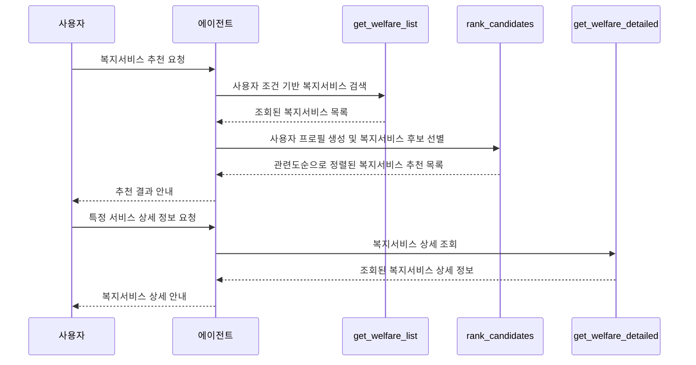

# 복지서비스 추천 MCP 서버

사용자 조건에 맞는 복지서비스를 추천하고, 관심 있는 서비스의 상세 정보를 제공하는 MCP 서버입니다.

생애주기·가구상황·관심주제·거주지역 등의 조건으로 복지서비스를 검색해 관련도순으로 추천하고, 지원 대상·선정 기준·신청 방법 등의 상세 정보를 안내합니다.

공공데이터포털에서 제공하는 중앙부처 복지서비스 API와 지자체 복지서비스 API를 활용합니다.

## 실행 준비

### 사전 준비 사항

- Python 3.11 이상
- uv
- 공공데이터포털 Open API 서비스 키
  - 한국사회보장정보원 중앙부처 복지서비스
  - 한국사회보장정보원 지자체 복지서비스
- Cohere API 키

### 패키지 설치

```bash
uv sync
```

### 환경변수 설정

`.env.example` 파일을 `.env` 파일로 복사한 뒤 필요한 값을 입력합니다.

```bash
cp .env.example .env
```

## 사용 방법

### 서버 실행

```bash
uv run --env-file .env welfare-service-recommendation-mcp
```

### 서버 등록

FastMCP CLI를 사용해 MCP 서버를 Claude Desktop에 등록합니다.

```bash
fastmcp install claude-desktop src/welfare_service_recommendation_mcp/server.py:mcp --with-editable . --env-file .env
```

## 동작 방식



## 도구 명세

### 1. get_welfare_list

- **목적:** 사용자 조건에 맞는 중앙부처 및 지자체 복지서비스를 검색
- **입력:**

  | 파라미터 | 설명 |
  | --- | --- |
  | `search_word` | 검색어 |
  | `life_cycle` | 생애주기 |
  | `household_type` | 가구상황 |
  | `interest_theme` | 관심주제 |
  | `age` | 나이 |
  | `province` | 시도명 |
  | `district` | 시군구명 |
  | `scope` | 검색 범위 |

- **출력:** 조회된 복지서비스 목록
- **사용 API:**
  - 중앙부처 복지서비스 목록 조회 API
  - 지자체 복지서비스 목록 조회 API

### 2. rank_candidates

- **목적:** 사용자 프로필과 복지서비스 후보를 비교해 관련도순으로 정렬
- **입력:**

  | 파라미터 | 설명 |
  | --- | --- |
  | `user_profile` | 사용자의 상황과 요구사항을 요약한 프로필 |
  | `candidates` | 조회된 복지서비스 중 사용자에게 적합하다고 판단한 후보 목록 |

- **출력:** 관련도가 높은 순으로 정렬된 복지서비스 추천 목록
- **사용 API:** Cohere Rerank API

### 3. get_welfare_detailed

- **목적:** 중앙부처 및 지자체 복지서비스의 상세 정보를 조회
- **입력:**

  | 파라미터 | 설명 |
  | --- | --- |
  | `service_id` | 복지서비스 ID |
  | `provider` | 서비스 제공처 |

- **출력:** 조회된 복지서비스 상세 정보
- **사용 API:**
  - 중앙부처 복지서비스 상세 조회 API
  - 지자체 복지서비스 상세 조회 API
